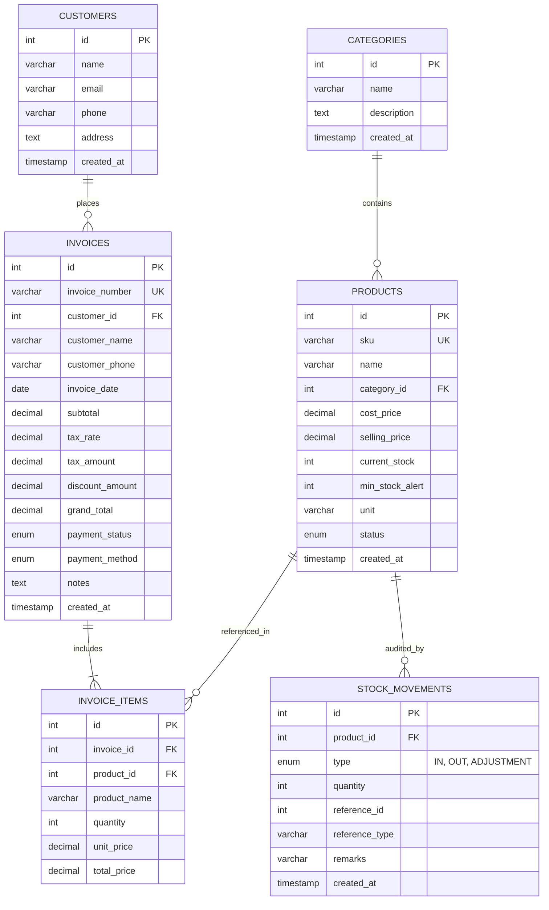

# 📦 Billing & Inventory Management System (BillTrack)

[](https://www.php.net/)
[](https://www.mysql.com/)
[](LICENSE)
[](#)
[](https://github.com/)

A modern, centralized web-based platform built in **PHP and MySQL** to automate point-of-sale invoicing, real-time stock deduction, and inventory replenishment. Designed to replace error-prone manual paper record-keeping with an ACID-compliant transactional workflow.

---

## 📌 Project Highlights & Core Impact

* **Centralized Web Platform:** Replaced manual ledger record-keeping with a synchronized PHP & MySQL application accessible across store terminals.
* **Relational Database Architecture:** Designed an enterprise-ready relational schema across `categories`, `products`, `customers`, `invoices`, `invoice_items`, and `stock_movements`.
* **Real-time Atomic Stock Deductions:** Implemented strict database transactions (`START TRANSACTION ... COMMIT / ROLLBACK`) ensuring stock counts decrement simultaneously during sales bill generation with row-level locks.
* **Automated Billing Workflow:** Reduced manual invoice preparation time by over 80% through dynamic client-side item calculation, live price lookup, and print-ready tax invoice rendering.

---

## 🚀 Key Features

### 🛒 1. Interactive Point of Sale (POS) Billing Counter
* Real-time item lookup with instantaneous unit price and available stock validation.
* Dynamic row addition/removal with automatic calculations for row totals, taxable subtotal, percentage tax rate, discounts, and grand totals.
* Out-of-stock and stock-cap guardrails preventing sales exceeding current on-hand quantities.

### 📊 2. Real-Time Stock Management & Audit Trail
* **Automated Stock Decrement:** Product stock decrements immediately upon invoice generation.
* **Audit Movement Log:** Every single inventory shift is logged in `stock_movements` with transaction timestamps, quantity deltas, and reference IDs (Inflow, Outflow, Adjustments, Cancellations).
* **Stock In & Physical Audit Counter:** Dedicated interface to restock inventory shipments or record physical audit corrections.

### ⚠️ 3. Low Stock Alert System
* Configurable low-stock thresholds (`min_stock_alert`) per product.
* Real-time visual dashboard banners flagging items needing urgent vendor replenishment.
* Color-coded status badges: `In Stock`, `Low Stock`, and `Out of Stock`.

### 🖨️ 4. Print-Ready A4 Tax Invoices
* Clean, professional invoice view with company letterhead, bill-to customer details, itemized breakdown, and terms.
* Dedicated `@media print` stylesheet that strips navigation sidebars, headers, and buttons for clean A4 printing or PDF export.

### 👥 5. Customer Directory & Sales Records
* Comprehensive directory tracking customer profiles, contact numbers, billing addresses, and historical spending.
* Invoice cancellation support with automatic stock rollback to inventory.

---

## 🏗️ Relational Database Schema (ER Diagram)



---

## 📁 Repository Directory Structure

```text
billing-inventory-management/
├── .github/
│   └── workflows/
│       └── code-quality.yml    # Automated CI syntax linter
├── api/
│   └── get_product.php         # AJAX endpoint for live product & stock lookup
├── assets/
│   ├── css/
│   │   ├── style.css           # Modern dashboard responsive styling
│   │   └── print.css           # Clean A4 print stylesheet for invoices
│   └── js/
│       ├── main.js             # Navigation, alert dismissals, table search
│       └── billing.js          # Dynamic billing POS calculator & stock guardrails
├── config/
│   ├── database.php            # PDO database connection with error fallback
│   └── database.example.php    # Template configuration file
├── database/
│   └── schema.sql              # Relational schema with full seed data
├── includes/
│   ├── functions.php           # Helper functions & invoice ID generators
│   ├── header.php              # Global navigation header
│   ├── sidebar.php             # Modern responsive sidebar
│   └── footer.php              # Global footer scripts
├── index.php                   # Dashboard with KPIs, alerts & recent transactions
├── products.php                # Product inventory catalog with category filters
├── product_add.php             # New product master creation form
├── product_edit.php            # Edit product specifications & pricing
├── stock_adjust.php            # Stock In, Stock Out & Audit logging interface
├── customers.php               # Customer CRM directory
├── customer_add.php            # Customer registration
├── invoices.php                # Invoices transaction history & cancellation
├── invoice_create.php          # Point of Sale billing terminal
├── invoice_view.php            # Printable & downloadable tax invoice layout
├── docker-compose.yml          # One-command container orchestration
├── Dockerfile                  # PHP 8.2 Apache container configuration
├── .gitignore                  # Git ignore rules for clean repo hygiene
├── LICENSE                     # MIT License
└── README.md                   # Documentation & Setup guide
```

---

## ⚙️ Installation & Setup Guide

### Option 1: Standard Setup (XAMPP / WAMP / LAMP)

1. **Clone or Copy Repository:**
   Move the project directory into your web root (e.g., `C:/xampp/htdocs/billing-inventory-system` or `/var/www/html/`).

2. **Start Services:**
   Start **Apache** and **MySQL** via your control panel (e.g., XAMPP Control Panel).

3. **Import Database Schema:**
   * Open **phpMyAdmin** (`http://localhost/phpmyadmin/`) or MySQL CLI.
   * Create a new database named `billing_inventory_db`.
   * Import `database/schema.sql`. (Includes initial schema and realistic seed data).

   ```bash
   mysql -u root -p billing_inventory_db < database/schema.sql
   ```

4. **Configure Database Credentials:**
   Check `config/database.php`. By default, it connects to `127.0.0.1:3306`, database `billing_inventory_db`, user `root`, and empty password `""`. Update if your environment uses custom credentials.

5. **Launch in Browser:**
   Open:
   ```
   http://localhost/billing-inventory-system/
   ```

---

### Option 2: 1-Click Docker Setup

If Docker is installed on your machine:

```bash
# Clone the repository
git clone https://github.com/YOUR_USERNAME/billing-inventory-system.git
cd billing-inventory-system

# Start containers
docker compose up -d
```

* **Web Application:** `http://localhost:8080`
* **MySQL Database Port:** `3307` (Root password: `rootpassword`)

---

## 🛠️ Step-by-Step GitHub Deployment

To push this repository to your GitHub profile:

1. **Create a New Repository on GitHub:**
   * Go to [GitHub New Repository](https://github.com/new).
   * Name: `billing-inventory-management-system` (or `billing-inventory-system`).
   * Description: `Centralized Billing & Inventory Management System in PHP & MySQL with real-time stock deduction and POS invoicing.`
   * Set visibility to **Public**.
   * Leave "Initialize with README" **unchecked** (we already have a complete one).

2. **Initialize Git & Push from Terminal:**

```bash
cd "C:\Users\DELL\.gemini\antigravity\scratch\billing-inventory-system"

# Initialize git repository
git init

# Add all files
git add .

# Create initial commit
git commit -m "feat: initial release of billing & inventory management system"

# Rename default branch to main
git branch -M main

# Link to your remote GitHub repository
git remote add origin https://github.com/YOUR_USERNAME/billing-inventory-system.git

# Push to GitHub
git push -u origin main
```

---

## 💻 Tech Stack Summary

* **Backend:** PHP 8.x (Object-Oriented PDO, ACID Database Transactions, Prepared Statements)
* **Database:** MySQL / MariaDB (Relational constraints, Foreign Keys, Row-Level Locking with `FOR UPDATE`)
* **Frontend:** Semantic HTML5, Custom Responsive CSS3 (Modern Flexbox/Grid, CSS Custom Properties), Vanilla JavaScript (ES6+ Fetch API, DOM manipulation)
* **Icons & Fonts:** FontAwesome 6, Google Inter Typography
* **DevOps & Containers:** Docker, Docker Compose, GitHub Actions CI

---

## 📜 License

This project is licensed under the [MIT License](LICENSE) - feel free to use, modify, and distribute for personal and educational projects.
